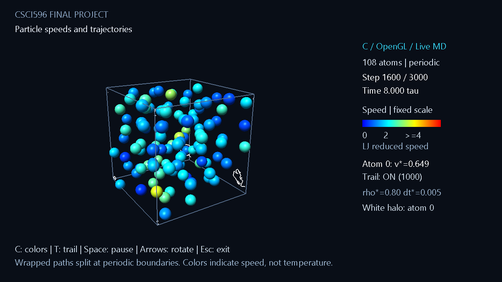
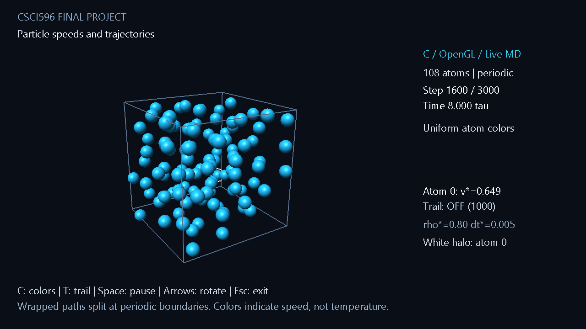
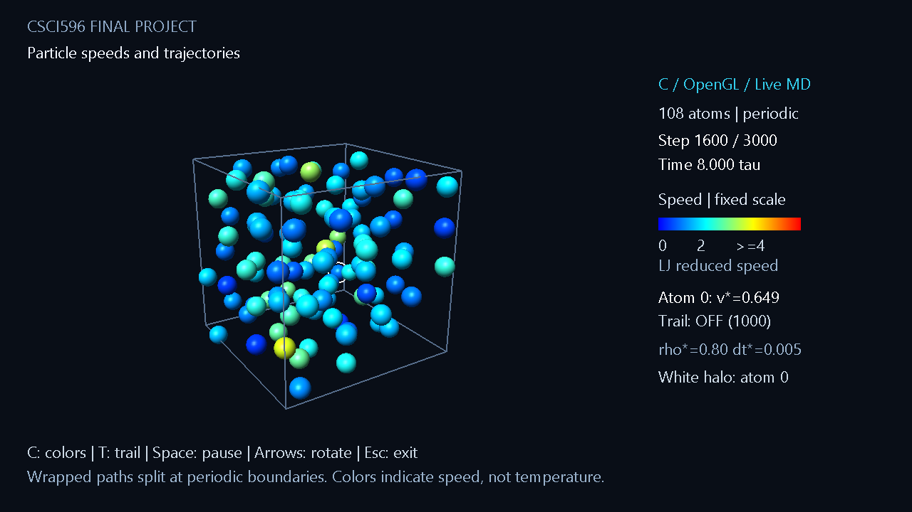

# Particle Speeds and Trajectories in Molecular Dynamics

CSCI 596 Final Project | Fall 2026 | Jiazhen Niu | Individual project

**Presentation: November 30, 2026.** Topic approved by Professor Aiichiro Nakano. [One-minute speaking script](docs/PRESENTATION.md) · [Report](docs/REPORT.md) · [Verification](output/verification.json)

An extension of a course C/OpenGL molecular-dynamics viewer: fixed-scale speed colors reveal fast and slow particles, and a periodic-boundary-aware trail shows the recent path of atom 0.



**Status:** implemented and locally verified; topic approved. Classroom presentation and final submission are upcoming. The project does not claim new molecular-dynamics physics or improved simulation performance.

## What is new?

| Existing AS07 viewer | Final Project additions |
| --- | --- |
| Uniform cyan atoms | Speed-dependent blue/cyan/yellow/red colors with a fixed 0–4 LJ speed scale |
| Current positions only | Last 1,000 integration-step positions of atom 0; no false line across periodic boundaries |
| Pause and rotation | C/T feature toggles, selected-atom halo, speed legend |
| Movie-oriented frame logging | Read-only per-step CSV, headless verification and reproducible native screenshots |

The force calculation and velocity-Verlet integrator are unchanged. The fixed color scale clips speeds above 4 to red. Individual speed is not temperature. Trajectories are wrapped and split at boundaries; they are not unwrapped paths or diffusion measurements.

## Run on Windows x64

With the locally built executable, double-click **run_demo.cmd**. No Python is needed to run the viewer. An OpenGL-capable graphics driver is required. The executable is a local build artifact and is excluded from source control.

To build from a fresh clone, install/use Zig 0.14.1 and run in PowerShell from this directory:

```powershell
.\build.ps1 -Zig 'C:\path\to\zig.exe'
.\run_demo.ps1
```

The build script also finds the existing compiler in this USC workspace when available. For a new computer, pass its compiler path explicitly. If local PowerShell policy blocks scripts, use `powershell.exe -NoProfile -ExecutionPolicy Bypass -File .\build.ps1 -Zig 'C:\path\to\zig.exe'` for that invocation.

| Key | Action |
| --- | --- |
| C | Switch uniform/speed colors |
| T | Hide/show the trajectory (sampling continues) |
| Space | Pause/resume physics and trajectory sampling |
| Arrow keys | Rotate the scene |
| Esc | Close and finish writing output files |

The simulation stops advancing at step 3000; the window remains interactive until closed. CSV is saved automatically with prefix `output/run`. Prefer Esc to closing the terminal so files are finalized.

## Reproduce verification and screenshots

Python 3 is required for the verification runner. Only screenshot conversion additionally needs Pillow.

```powershell
python tests/verify.py
python -m pip install Pillow
python tests/make_screenshots.py
```

Verification results are stored in [output/verification.json](output/verification.json). The checked default case has 108 particles and 3,000 integration steps. All-particle final position/velocity CSV is byte-identical to an independent driver of the preserved original integrator. All 3,001 per-step energy samples match. The actual control handler and simulation tick pass pause/resume and feature-toggle tests. Synthetic crossings in both directions on all three axes pass.

The default run detected **34 boundary crossings** for atom 0 over the complete simulation. The trail retains at most 1,000 samples. Maximum observed displacement per axis was **0.00610 times half the corresponding box length**, below the half-box assumption used to identify boundary crossings. The maximum absolute total-energy drift per atom was **0.000909221** (about **0.0237%** of the absolute initial energy).

The screenshot command captures the actual OpenGL framebuffer three times at the same step, 1600:

| Uniform display | Speed colors | Colors and trail |
| --- | --- | --- |
|  |  |  |

The screenshots illustrate features; the numerical verification above uses a full 3,000-step run.

## Input and output

The original eight-field input format is retained, with whitespace-separated values:

```text
3 3 3   # FCC unit cells along x, y, z (see note below)
0.8     # density
1.0     # initial temperature parameter
0.005   # integration time step
3000    # final integration step
10      # steps per interactive frame
```

**The comments above are explanatory only. Actual input files must contain numbers only**, as in [examples/default.in](examples/default.in). Fields use reduced Lennard-Jones units. The FCC configuration contains `4*nx*ny*nz` atoms. Each half-box must exceed the interaction cutoff 2.5. All tested parameters are inherited from AS07; no temperature equilibration or thermostat is added.

```powershell
.\bin\md_visualizer.exe --headless --output output/experiment examples/default.in
.\bin\md_visualizer.exe --no-color --no-trail --output output/uniform examples/default.in
.\bin\md_visualizer.exe --snapshot output/demo --snapshot-step 1600 --output output/snapshot examples/default.in
```

`--output` and `--snapshot` take filename prefixes; their parent directories must already exist. Run direct commands from the project root. Headless mode skips rendering; it retains the same simulation and trajectory sampling. It cannot be combined with snapshot mode. Snapshot mode creates PPM files; the Python helper converts them to PNG.

| File suffix | Contents |
| --- | --- |
| `_metrics.csv` | Each step including 0: time, atom-0 coordinates and speed, system temperature, total/kinetic/potential energy per atom |
| `_state.csv` | Every atom's final position and velocity |
| `_summary.json` | Steps, particle count, trail capacity, crossing count, energy drift, displacement guard |

## Documents and attribution

- [Project report](docs/REPORT.md): method, validation, results and limitations.
- [中文入门与操作指南](docs/START_HERE_ZH.md): understand the project before presenting it.
- [One-minute presentation](docs/PRESENTATION.md): English outline for showing this repository.
- [中文汇报练习清单](docs/REHEARSAL_ZH.md): rehearsal steps and checks for November 30.
- [Pre-presentation status](docs/PRE_PRESENTATION_STATUS.md): completed checks and remaining personal steps.
- [Submission checklist](docs/SUBMISSION.md): remaining course and submission steps.
- [Sources and contribution boundaries](docs/SOURCES.md): original course sources, AS07 work and new code.

This repository contains inherited instructional code. No license for that code has been established, so no blanket open-source license is asserted. Check course policy and attribution before choosing public repository visibility.
