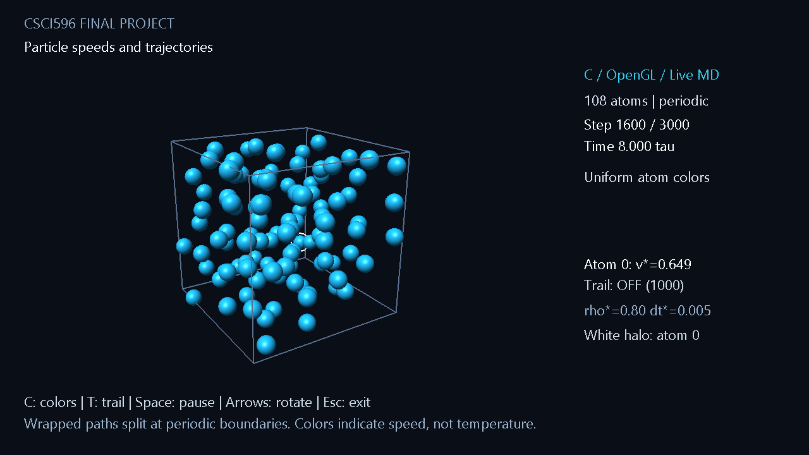
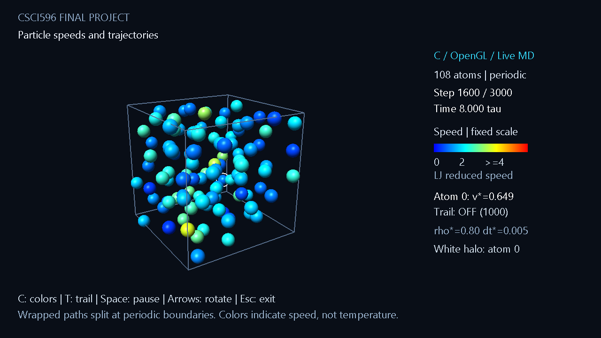
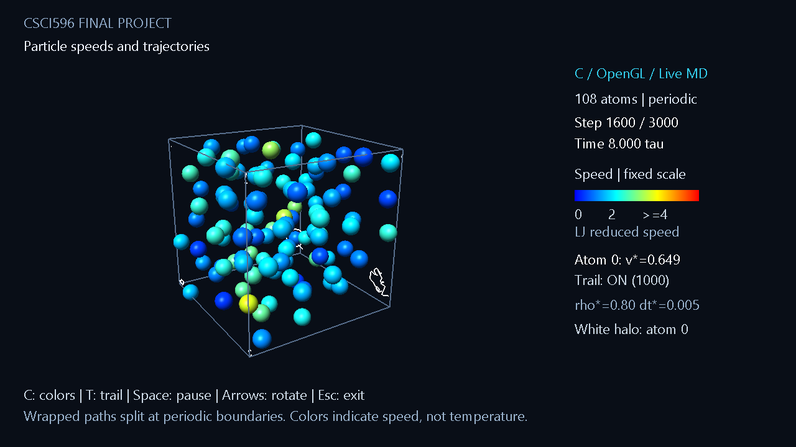

# Visualizing Particle Speeds and Trajectories in Molecular Dynamics

## Problem and objective

The AS07 viewer displays identical cyan spheres at their instantaneous positions. It is difficult to identify fast particles or follow one particle through time. Periodic boundaries also require care: a particle exiting one face reappears on the opposite face, and naively connecting consecutive displayed positions produces a false line across the box.

This individual project extends that viewer with fixed-scale speed coloring and a boundary-aware recent trajectory. Its goal is a more informative scientific visualization while preserving the underlying calculation.

## Model and inherited implementation

The course supplies the Lennard-Jones force calculation and velocity-Verlet integrator in `original/md.c` and `original/md.h`. The system uses periodic boundary conditions, a force-shifted cutoff of 2.5, and reduced Lennard-Jones units. The default case uses 108 atoms in 3 by 3 by 3 FCC unit cells, density 0.8, initial temperature parameter 1.0, time step 0.005, and 3,000 steps. Removing center-of-mass motion changes the realized initial temperature slightly; the input parameter is not a guaranteed equilibrated temperature.

The AS07 C/OpenGL viewer supplies the window, sphere rendering, rotation and pause behavior. These are inherited contributions, rather than new Final Project features. The original files are preserved for comparison.

## Visualization method

For particle i, speed is `sqrt(vx*vx + vy*vy + vz*vz)`. A piecewise-linear blue–cyan–yellow–red map uses a fixed 0–4 speed range. The map clips larger speeds to red. A fixed legend allows the same color to retain the same interpretation across frames. Color denotes speed, not a temperature estimate for one atom.

Atom 0 is marked with a white halo. A ring buffer retains the last 1,000 positions, sampled after every integration step independently of frame rate or the trail visibility toggle. Consecutive points are drawn only when no coordinate difference exceeds half of the corresponding periodic box length. A boundary crossing therefore produces a gap instead of an artificial long segment. This is a wrapped path; the implementation does not reconstruct an unwrapped trajectory.

The half-box test requires the true per-step displacement to be smaller than half a box length along each axis. For the supplied velocity-Verlet scheme, the completed step's drift is reconstructed as `dt * (v_final - dt/2 * a_final)`. The viewer checks this bound for all particles at every step and stops with a diagnostic if it is violated. Tracking a displacement bound makes the boundary assumption explicit; it does not guarantee numerical accuracy at arbitrary time steps.

Observations are read-only. In particular, the extension does not call the inherited `EvalProps()` during rendering, because that routine normalizes the global potential-energy accumulator in place. CSV temperature and energies are calculated in local variables. Pausing stops both simulation and new samples; rendering and camera operations do not advance the model.

## Validation and results

Tests are reproduced by building and running `python tests/verify.py`. The independent reference driver calls the preserved original integrator without the visualization helpers.

| Check | Observed result |
| --- | --- |
| All-particle final state | Final positions and velocities for all 108 atoms are byte-identical to the reference CSV after 3,000 steps |
| Per-step energy | All 3,001 printed samples, including step 0, match exactly with the same arithmetic order |
| Feature combinations | All four initial color/trail combinations preserve metrics and final state |
| Colors | Known 0, 2 and 4 speeds and clipping outside the scale pass |
| Periodic boundary handling | Synthetic forward/backward crossings on each axis are rejected as line segments; ordinary motion connects |
| History | Capacity remains 1,000 and chronological order survives buffer wrap |
| Actual event handler | Pause/resume, C/T toggles and exit pass; paused coordinates, velocities, step and history remain unchanged |
| Invalid input | Malformed input, too-small box, zero time step, incompatible and unknown flags fail |

In the full default run, atom 0 crosses periodic boundaries 34 times. The maximum observed per-axis step displacement divided by half-box length is 0.0060999785. The maximum absolute energy drift per atom is 0.0009092209, approximately 0.0237% relative to the magnitude of the initial energy per atom, -3.84246862. This drift is inherited from the original finite-step simulation; the visualization does not change it.

The three screenshots below are actual native OpenGL captures at step 1600, not illustrations or independently simulated cases.

Colors expose instantaneous speed variation. The white trail provides time context; the gaps correctly avoid cross-box artifacts. These are visualization observations, not evidence of equilibrium, a phase transition, or a diffusion coefficient.

## Limitations and future work

The implementation targets Windows and legacy OpenGL, tracks only atom 0, and shows a bounded recent history. Other particles may occlude parts of the path or halo. Clipping at speed 4 loses detail above that threshold. The original pairwise force calculation scales quadratically, so the large original array capacity is not a practical interactive-performance guarantee. The project makes no speedup claim and includes no performance benchmark.

Potential future extensions include selectable particles, an unwrapped path view and equilibrated statistical analysis. They are outside the current implementation.

## Contributions and references

This is an individual Final Project. New work consists of the speed map and legend, selected-particle halo, sampled trajectory and periodic segmentation, controls, read-only data output, verification and documentation. The force model, integrator, sphere geometry and base viewer are inherited. See [SOURCES.md](SOURCES.md) for exact boundaries and course links. Implementation assistance was provided by Codex; the student should understand the code and follow the instructor's policy on assistance and disclosure.
